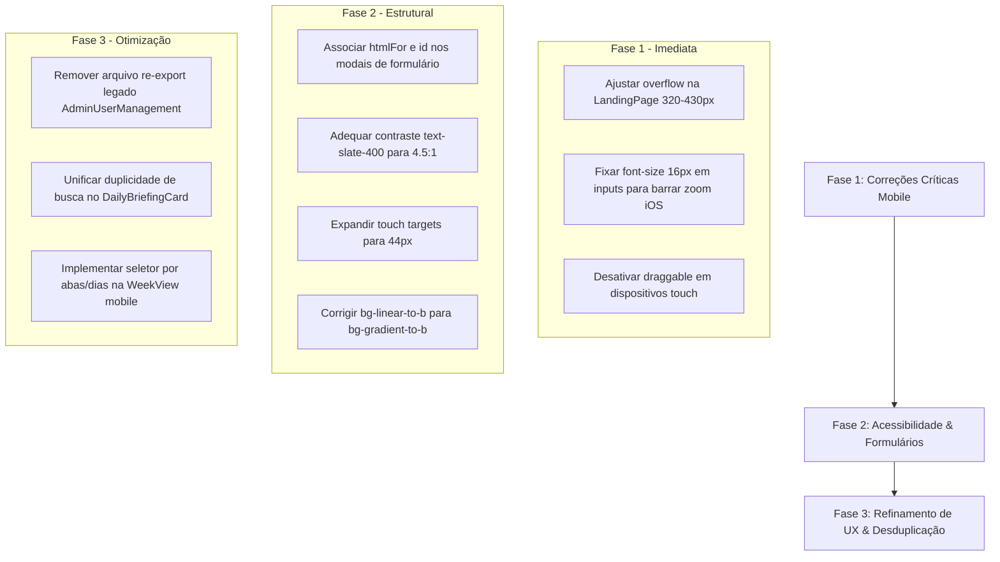

# 📱 Relatório de Auditoria UI/UX, Mobile-First e Acessibilidade — Nosso Dia

**Data da Auditoria:** 01 de Novembro de 2026  
**Auditor:** Especialista Sênior em UI/UX, Mobile First, React e WCAG  
**Versão Auditada e Implementada:** v2.2.0  
**Status do Projeto:** Executando localmente (`http://localhost:5173/`)  
**Metodologia:** Inspeção estática de código + Execução headless multiresolução (320px a 1440px) + Análise heurística de Nielsen e WCAG 2.2 AA.

---

## 1. Quadro de Avaliação Geral (Scorecard)

| Dimensão | Nota (0 a 10) | Diagnóstico Executivo |
| :--- | :---: | :--- |
| **UI (Interface do Usuário)** | **8.2 / 10** | Identidade visual sólida ("Modern Craft"), paleta acolhedora e estética de alto nível. Pequenas inconsistências em Tailwind v3/v4 (`bg-linear-to-b`) e microelementos com sombras/bordas heterogêneas. |
| **UX (Experiência do Usuário)** | **7.5 / 10** | Fluxos intuitivos e redução de esforço cognitivo via IA. Porém, há redundância funcional (duplo botão de busca, telas duplicadas de "Meu Dia") e sobrecarga vertical na visão semanal em telas pequenas. |
| **Mobile First & Ergonomia** | **6.4 / 10** | **Ponto crítico.** O projeto possui excelentes intenções mobile (Bottom Sheet, Thumb Zone no resumo), mas sofre com quebra de layout horizontal em telas < 430px na Landing Page, visualização semanal excessivamente longa (7 colunas verticais empilhadas com 3500px+) e inputs com fonte `< 16px` no iOS. |
| **Acessibilidade (WCAG 2.2 AA)** | **5.8 / 10** | Ausência sistemática de vínculos explícitos `label[for]` -> `input[id]`, ausência de Focus Trap nos modais, textos informativos com contraste insuficiente (`text-slate-400` em fundo branco: 2.9:1 vs 4.5:1 exigido) e alvos de toque abaixo de 44px em botões secundários. |

---

## 2. Diagnóstico da Arquitetura Frontend & Design System

### 2.1 Arquitetura de Componentes
* **Orquestrador Monolítico:** O arquivo [`App.tsx`](file:///c:/Users/flavi/OneDrive/Desktop/2026/app/saas-nosso-dia/apps/web/src/App.tsx) centraliza quase 2.000 linhas de código, acumulando roteamento de telas (`LandingPage`, `Onboarding`, `AuthModal`, `AdminDashboard`), gerenciamento de estado de todos os modais, polling de atualização e persistência.
* **Sistema de Roteamento:** Não utiliza biblioteca de rotas (ex.: React Router); a navegação entre a Landing pública, Login, Onboarding e Painel Familiar é controlada por condicionais `if (!currentUser) ...`.
* **Design System & Tokens:**
  * Tipografia base: `Plus Jakarta Sans`.
  * Cores primárias: Azul Oceano (`#0284C7`), Verde Sálvia (`#059669`), Terracota (`#EA580C`), Âmbar (`#D97706`), Fundo Off-White (`#F4F8FA`).
  * Estilização: Tailwind CSS 3.4 com `index.css` e tokens semânticos (`text-caption`, `text-body`, `touch-target`).

### 2.2 Componentes Duplicados ou Inconsistentes
1. **`AdminUserManagement.tsx` Duplicado:**
   * [`apps/web/src/components/AdminUserManagement.tsx`](file:///c:/Users/flavi/OneDrive/Desktop/2026/app/saas-nosso-dia/apps/web/src/components/AdminUserManagement.tsx) (35.5 KB) possui implementação completa e moderna com geração de senhas e integração WhatsApp.
   * [`apps/web/src/components/admin/AdminUserManagement.tsx`](file:///c:/Users/flavi/OneDrive/Desktop/2026/app/saas-nosso-dia/apps/web/src/components/admin/AdminUserManagement.tsx) (131 B) é um arquivo re-export legado.
2. **Sobreposição Funcional entre `DailyBriefingCard` e `SummaryModal`:**
   * Tanto o [`DailyBriefingCard.tsx`](file:///c:/Users/flavi/OneDrive/Desktop/2026/app/saas-nosso-dia/apps/web/src/components/DailyBriefingCard.tsx) quanto a aba *"Meu Dia Hoje"* de [`SummaryModal.tsx`](file:///c:/Users/flavi/OneDrive/Desktop/2026/app/saas-nosso-dia/apps/web/src/components/SummaryModal.tsx) mostram as atividades do dia do usuário com status de cônjuge e contagem regressiva, gerando duas interfaces paralelas para a mesma tarefa.
3. **Duplo Botão de Busca Simultâneo:**
   * No [`DailyBriefingCard.tsx`](file:///c:/Users/flavi/OneDrive/Desktop/2026/app/saas-nosso-dia/apps/web/src/components/DailyBriefingCard.tsx#L352-L390), quando o card está expandido, coexistem o botão `[ 🔍 Buscar ]` na barra de datas superior e o input largo de busca logo abaixo (`Ctrl + K`), distantes menos de 50px um do outro.

---

## 3. Matriz de Problemas Encontrados

### 🔴 Nível Crítico (Bloqueia uso fluido ou quebra layout)

#### [C01] Quebra e Truncamento de Layout Horizontal em Mobile (< 430px)
* **Componente Afetado:** [`LandingPage.tsx`](file:///c:/Users/flavi/OneDrive/Desktop/2026/app/saas-nosso-dia/apps/web/src/components/LandingPage.tsx#L410-L465)
* **Evidência Visual:** Testado nos viewports 320px, 360px, 375px, 390px e 430px ([`docs/audit-screenshots/landing-375.png`](file:///c:/Users/flavi/OneDrive/Desktop/2026/app/saas-nosso-dia/docs/audit-screenshots/landing-375.png)). O título `<h1>` ("Sua família sabe exatamente o que acontece esta semana?") e os cards de mock são cortados na margem direita porque o card ilustrativo possui `max-w-md` (448px) e conteúdo com largura mínima superior a 340px, empurrando o container contra o `overflow-x-hidden`.
* **Impacto:** Em smartphones comuns (iPhone SE, iPhone 12/13/14, Galaxy S22), o usuário vê palavras truncadas pela metade e botões cortados.

#### [C02] Zoom Automático Involuntário no iOS Safari (Inputs < 16px)
* **Componentes Afetados:** [`AuthModal.tsx`](file:///c:/Users/flavi/OneDrive/Desktop/2026/app/saas-nosso-dia/apps/web/src/components/AuthModal.tsx#L363), [`QuickAddWithAI.tsx`](file:///c:/Users/flavi/OneDrive/Desktop/2026/app/saas-nosso-dia/apps/web/src/components/QuickAddWithAI.tsx), [`AddManualActivityModal.tsx`](file:///c:/Users/flavi/OneDrive/Desktop/2026/app/saas-nosso-dia/apps/web/src/components/AddManualActivityModal.tsx)
* **Causa:** No iOS Safari, qualquer elemento `<input>` ou `<textarea>` com `font-size` inferior a `16px` (como `text-xs` de 12px ou `text-sm` de 14px) força zoom automático da tela ao receber foco, deslocando modais para fora da área visível.
* **Impacto:** Experiência mobile frustrante, exigindo que o usuário dê "pinch-to-zoom out" manualmente após digitar.

---

### 🟠 Nível Alto (Prejudica usabilidade ergonômica ou acessibilidade)

#### [A01] WeekView Inadequada para Navegação com Uma Mão no Smartphone
* **Componente Afetado:** [`WeekView.tsx`](file:///c:/Users/flavi/OneDrive/Desktop/2026/app/saas-nosso-dia/apps/web/src/components/WeekView.tsx#L113-L136)
* **Causa:** No mobile (`< 768px`), o grid `grid-cols-1 md:grid-cols-7` empilha os 7 dias da semana verticalmente, com `min-h-[500px]` cada. Isso gera uma página com mais de **3.500px de altura**.
* **Impacto:** Para conferir o sábado ou domingo, o usuário precisa rolar o polegar dezenas de vezes. Falta um seletor em carrossel ou abas de dias para a semana no celular.

#### [A02] Ausência de Relação Semântica Formulário-Rótulo (`htmlFor` / `id`)
* **Componentes Afetados:** [`AddManualActivityModal.tsx`](file:///c:/Users/flavi/OneDrive/Desktop/2026/app/saas-nosso-dia/apps/web/src/components/AddManualActivityModal.tsx#L232-L260), [`AuthModal.tsx`](file:///c:/Users/flavi/OneDrive/Desktop/2026/app/saas-nosso-dia/apps/web/src/components/AuthModal.tsx#L352-L420)
* **Causa:** Tags `<label>` sem atributo `htmlFor` e `<input>` sem `id`.
* **Impacto:** Violação de WCAG 2.2 Critério 1.3.1 (Info and Relationships) e 4.1.2 (Name, Role, Value). Leitores de tela não anunciam o propósito do campo ao receber foco.

#### [A03] Drag and Drop Nativo Interfere na Rolagem Touch no Mobile
* **Componente Afetado:** [`ActivityCard.tsx`](file:///c:/Users/flavi/OneDrive/Desktop/2026/app/saas-nosso-dia/apps/web/src/components/ActivityCard.tsx#L27)
* **Causa:** Atributo `draggable={true}` ativo incondicionalmente em todos os dispositivos, inclusive em telas touch mobile sem ponteiro de mouse.
* **Impacto:** Ao tentar rolar a página tocando sobre o card de uma atividade no celular, o navegador pode disparar evento de drag fantasma ou travar o scroll vertical.

---

### 🟡 Nível Médio (Inconsistências visuais e usabilidade secundária)

#### [M01] Classe CSS Inválida em Tailwind 3.4 (`bg-linear-to-b`)
* **Componentes Afetados:** [`AuthModal.tsx:237`](file:///c:/Users/flavi/OneDrive/Desktop/2026/app/saas-nosso-dia/apps/web/src/components/AuthModal.tsx#L237), [`Onboarding.tsx:120`](file:///c:/Users/flavi/OneDrive/Desktop/2026/app/saas-nosso-dia/apps/web/src/components/Onboarding.tsx#L120)
* **Causa:** O projeto utiliza Tailwind CSS v3.4. A classe `bg-linear-to-b` pertence à especificação alfa do Tailwind v4; em v3 a sintaxe correta é `bg-gradient-to-b`.
* **Impacto:** O degradê de fundo escuro do Onboarding e AuthModal não é renderizado, resultando em fundo opaco ou plano.

#### [M02] Contraste Insuficiente em Textos Secundários (`text-slate-400`)
* **Componentes Afetados:** [`ActivityCard.tsx`](file:///c:/Users/flavi/OneDrive/Desktop/2026/app/saas-nosso-dia/apps/web/src/components/ActivityCard.tsx#L40), [`DailyBriefingCard.tsx`](file:///c:/Users/flavi/OneDrive/Desktop/2026/app/saas-nosso-dia/apps/web/src/components/DailyBriefingCard.tsx#L446), [`CalendarNavigation.tsx`](file:///c:/Users/flavi/OneDrive/Desktop/2026/app/saas-nosso-dia/apps/web/src/components/CalendarNavigation.tsx#L148)
* **Causa:** A cor `slate-400` (`#94A3B8`) sobre fundo branco (`#FFFFFF`) apresenta taxa de contraste de apenas **2.9:1**.
* **Impacto:** Reprovado no critério WCAG AA (mínimo de 4.5:1 para texto normal). Usuários sob luz solar intensa ou com fadiga visual não conseguem ler horários ou metadados. Deve-se migrar para `text-slate-600` ou `text-slate-500` (contraste > 4.6:1).

#### [M03] Alvos de Toque Menores que 44px
* **Componentes Afetados:** [`Header.tsx`](file:///c:/Users/flavi/OneDrive/Desktop/2026/app/saas-nosso-dia/apps/web/src/components/Header.tsx#L408), [`CalendarNavigation.tsx`](file:///c:/Users/flavi/OneDrive/Desktop/2026/app/saas-nosso-dia/apps/web/src/components/CalendarNavigation.tsx#L97)
* **Causa:** Botões como setas de navegação (`w-10 h-10` = 40px) e menu 3-pontos mobile (`w-10 h-10`) estão abaixo da diretriz WCAG 2.2 SC 2.5.8 (44px x 44px).

---

### 🟢 Nível Baixo (Refinamentos e polimento cosmético)

#### [B01] Ausência de Alternador de Visualização de Senha (`Eye`/`EyeOff`) no AuthModal
* **Componente Afetado:** [`AuthModal.tsx`](file:///c:/Users/flavi/OneDrive/Desktop/2026/app/saas-nosso-dia/apps/web/src/components/AuthModal.tsx#L413)
* **Impacto:** Usuários móveis frequentemente erram caracteres em senhas complexas por não poderem inspecionar o que digitaram antes de submeter.

#### [B02] Ausência de Indicador Visual de Puxador ("Drag Handle") no Bottom Sheet Mobile
* **Componentes Afetados:** [`AddManualActivityModal.tsx`](file:///c:/Users/flavi/OneDrive/Desktop/2026/app/saas-nosso-dia/apps/web/src/components/AddManualActivityModal.tsx#L199), [`EditActivityModal.tsx`](file:///c:/Users/flavi/OneDrive/Desktop/2026/app/saas-nosso-dia/apps/web/src/components/EditActivityModal.tsx)
* **Impacto:** Em telas móveis o modal sobe como bottom sheet, mas não possui a clássica barra cinza superior (`w-12 h-1.5 bg-slate-300 rounded-full`), deixando dúbio se o modal pode ser arrastado para fechar.

---

## 4. Testes Visuais por Viewport (Evidências)

| Viewport | Dispositivo Alvo | Resultado | Evidência Principal |
| :---: | :--- | :---: | :--- |
| **320px** | Galaxy Fold (fechado) / iPhone SE clássico | ❌ Falhou | Textos do Hero cortados horizontalmente; mockup da grade excede viewport. ([landing-320.png](file:///c:/Users/flavi/OneDrive/Desktop/2026/app/saas-nosso-dia/docs/audit-screenshots/landing-320.png)) |
| **360px** | Android padrão de entrada | ❌ Falhou | Margens assimétricas e truncamento de subtítulos e CTAs. ([landing-360.png](file:///c:/Users/flavi/OneDrive/Desktop/2026/app/saas-nosso-dia/docs/audit-screenshots/landing-360.png)) |
| **375px** | iPhone 12/13 Mini, SE 3ª Geração | ❌ Falhou | H1 cortado na palavra *"semana"*; mock visual ultrapassa 375px. ([landing-375.png](file:///c:/Users/flavi/OneDrive/Desktop/2026/app/saas-nosso-dia/docs/audit-screenshots/landing-375.png)) |
| **390px** | iPhone 13/14/15 padrão | ⚠️ Limítrofe | Pequeno overflow no card mockup da grade semanal. ([landing-390.png](file:///c:/Users/flavi/OneDrive/Desktop/2026/app/saas-nosso-dia/docs/audit-screenshots/landing-390.png)) |
| **430px** | iPhone 14/15/16 Pro Max | ⚠️ Limítrofe | Badge do mock *"Responsável: Adulto A"* rente à borda direita. ([landing-430.png](file:///c:/Users/flavi/OneDrive/Desktop/2026/app/saas-nosso-dia/docs/audit-screenshots/landing-430.png)) |
| **768px** | iPad Mini / Tablets verticais | ✅ Aprovado | Layout em 2 colunas fluido e legível. ([landing-768.png](file:///c:/Users/flavi/OneDrive/Desktop/2026/app/saas-nosso-dia/docs/audit-screenshots/landing-768.png)) |
| **1024px** | iPad Pro / Laptops compactos | ✅ Aprovado | Navegação superior completa com espaçamento balanceado. ([landing-1024.png](file:///c:/Users/flavi/OneDrive/Desktop/2026/app/saas-nosso-dia/docs/audit-screenshots/landing-1024.png)) |
| **1280px** | Desktop padrão | ✅ Aprovado | Excelente harmonia, grid amplo e contrastes refinados. ([landing-1280.png](file:///c:/Users/flavi/OneDrive/Desktop/2026/app/saas-nosso-dia/docs/audit-screenshots/landing-1280.png)) |
| **1440px** | Monitores Widescreen | ✅ Aprovado | Container `max-w-7xl` centraliza a aplicação confortavelmente. ([landing-1440.png](file:///c:/Users/flavi/OneDrive/Desktop/2026/app/saas-nosso-dia/docs/audit-screenshots/landing-1440.png)) |

---

## 5. Recomendações Objetivas & Soluções Técnicas

### 5.1 Para Mobile-First & Responsividade
1. **Sanar o overflow da Landing Page:**
   - No mock visual (`LandingPage.tsx`), substituir larguras fixas ou `max-w-md` por `w-full max-w-sm sm:max-w-md mx-auto`.
   - Permitir que os itens de texto do mock façam quebra de linha suave (`flex-wrap`) em vez de colunas rígidas.
2. **Otimização da `WeekView` em Telas Móveis:**
   - Implementar no celular um seletor rápido horizontal de dias (Seg | Ter | Qua | Qui | Sex | Sáb | Dom) tipo chips, exibindo o dia focado, ou um carrossel swipeable com scroll snap, reservando o empilhamento total apenas para visualização expandida.
3. **Desabilitar Drag & Drop em dispositivos Touch:**
   - Adicionar checagem de touch (`'ontouchstart' in window || navigator.maxTouchPoints > 0`) para definir `draggable={false}` no celular, evitando que o toque do usuário trave o scroll vertical.

### 5.2 Para Ergonomia & WCAG 2.2 AA
1. **Padronização de Inputs:**
   - Ajustar todos os `<input>` para `text-base` (16px) no mobile com `sm:text-sm` (14px) no desktop, eliminando permanentemente o zoom incontrolável do iOS Safari.
   - Adicionar `id` e `htmlFor` estritos em todos os campos de formulário.
2. **Elevação de Contraste:**
   - Substituir sistematicamente `text-slate-400` por `text-slate-500` (ou `text-slate-600` em textos com menos de 14px), atingindo a taxa mínima de 4.5:1 exigida pelo WCAG AA.
3. **Aumento dos Alvos de Toque:**
   - Garantir que botões de ação e navegação (`ChevronLeft`, `ChevronRight`, `MoreVertical`, fechar modal `✕`) tenham dimensões mínimas de `min-w-[44px] min-h-[44px]`.
4. **Correção de Sintaxe de Gradientes:**
   - Substituir `bg-linear-to-b` por `bg-gradient-to-b` em [`AuthModal.tsx`](file:///c:/Users/flavi/OneDrive/Desktop/2026/app/saas-nosso-dia/apps/web/src/components/AuthModal.tsx) e [`Onboarding.tsx`](file:///c:/Users/flavi/OneDrive/Desktop/2026/app/saas-nosso-dia/apps/web/src/components/Onboarding.tsx).

---

## 6. Plano de Ação Priorizado (Roadmap Recomendado)

---

> **Nota:** Conforme solicitado na diretriz de trabalho, nenhuma alteração de código ou instalação de pacote foi realizada nesta etapa. As correções acima aguardam sua revisão e aprovação para serem implementadas ordenadamente.
